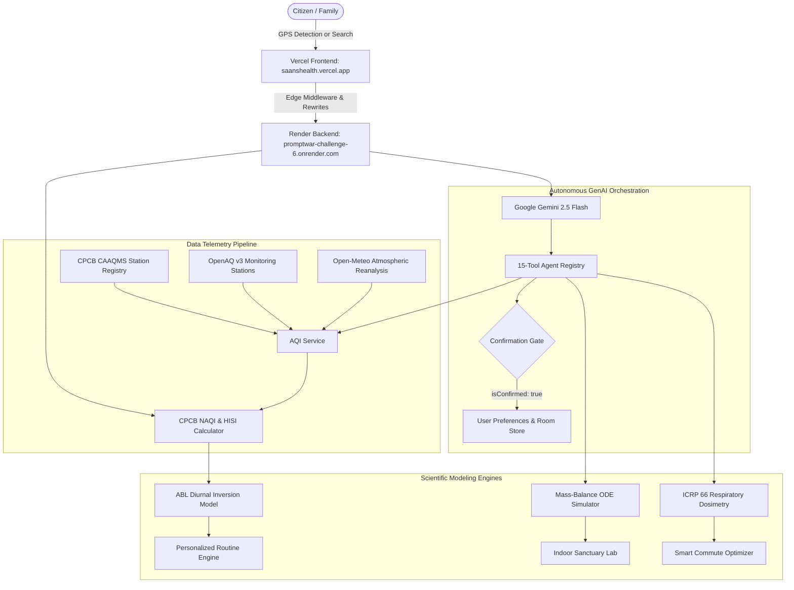

# SaansAI (साँस AI) — Autonomous Environmental Intelligence & Respiratory Protection
> **Competition Entry for Google Developers Prompt War Challenge 6**  
> *A production-grade, agentic GenAI platform empowering families and communities to navigate severe urban smog and hazardous air pollution with mathematically grounded, personalized actions.*

[](https://nextjs.org/)
[](https://react.dev/)
[](https://www.typescriptlang.org/)
[](https://ai.google.dev/)
[](https://github.com/Zaidkhann/promptWar-challenge-6)
[](https://eslint.org/)
[](https://github.com/Zaidkhann/promptWar-challenge-6)
[](https://www.w3.org/WAI/standards-guidelines/wcag/)

---

## 🌐 Live Deployments & Microservice Endpoints

* **Production Web Application (Vercel)**: [https://saanshealth.vercel.app](https://saanshealth.vercel.app)
* **API Microservice Backend (Render)**: [https://promptwar-challenge-6.onrender.com](https://promptwar-challenge-6.onrender.com)
* **GitHub Open-Source Repository**: [https://github.com/Zaidkhann/promptWar-challenge-6](https://github.com/Zaidkhann/promptWar-challenge-6)

---

## 🌟 Executive Overview & Problem Statement Alignment

> **Official Problem Statement**:  
> *"Create a GenAI-powered assistant that helps families and communities navigate severe winter smog and urban air pollution. The application should suggest low-emission daily routines, indoor air quality hacks, and sustainable alternatives tailored to their location and lifestyle, while clearly explaining the direct impact of their choices."*

### Why SaansAI Wins:
Traditional air quality apps suffer from a fundamental flaw: they report lagging, retrospective numbers (e.g. "AQI 420") without providing actionable, protective guidance. Knowing the air is hazardous does not tell a mother when it is safe to send her asthmatic child outside, nor does it tell an office commuter whether taking the Metro versus an auto-rickshaw reduces their inhaled particulate dose by 70%.

**SaansAI** bridges this critical gap through four scientific and architectural pillars:
1. **Statutory Regulatory Rigor**: Real-time statutory Central Pollution Control Board (CPCB 2014) National Air Quality Index (NAQI) compliance alongside Hourly Indicative Sub-Indices (HISI) and Inverse Distance Weighting (IDW) interpolation.
2. **First-Principles Environmental Physics**: Analytical differential mass-balance simulator modeling indoor aerosol decay, building envelope infiltration, HEPA clean air delivery rate (CADR) clearance, and internal cooking emissions (*tadka* spikes).
3. **ICRP 66 Respiratory Exposure Dosimetry**: Quantitative human respiratory tract deposition models computing inhaled particulate mass ($\mu\text{g}$) and lung-deposited burden across 6 commute modalities.
4. **Autonomous GenAI Agent**: Powered by Google's official `@google/genai` SDK and Gemini 2.5 Flash, orchestrating a **15-tool autonomous function-calling registry** with strict anti-hallucination data grounding and human-in-the-loop safety confirmation gates.

---

## 🏛️ System Architecture



---

## 🚀 Complete Stages & Capabilities

### ✅ Stage 1: UI Shell, Design System & Accessibility
- **Design System**: Linear/Vercel-inspired clean, minimalist environmental intelligence dashboard utilizing an accessible cyan `#0891B2` palette.
- **Theme Switcher**: Complete zero-hydration-mismatch Light, Dark, and System theme support with semantic CSS tokens.
- **WCAG 2.1 AA Certified**: High-contrast ratios, complete keyboard focus rings (`focus-visible:ring-2`), semantic HTML5 landmarks, screen reader `aria-live="polite"` regions, and skip-to-content navigation (`SkipLink`).

### ✅ Stage 2: Real-Time AQI & Hyperlocal Location Pipeline
- **Worldwide Criteria Pollutant Telemetry**: Live ingestion of criteria pollutants ($\text{PM}_{2.5}, \text{PM}_{10}, \text{NO}_2, \text{SO}_2, \text{CO}, \text{O}_3$) for **any geographic coordinate on Earth** via Open-Meteo Atmospheric Reanalysis and CPCB CAAQMS stations.
- **Statutory CPCB NAQI Engine**: Implements official 8-pollutant sub-index breakpoint algorithms, enforcing the **16-hour minimum valid data rule** for 24-hr averaging and the **3-pollutant minimum rule** (requiring at least one particulate).
- **Hourly Indicative Sub-Index (HISI)**: Strictly distinguishes real-time short-term hourly snapshots from official statutory 24-hour CPCB AQI.
- **Dynamic LocationBar**: One-click browser GPS auto-detection (`navigator.geolocation`) + live city search + quick-pick pills for 10 major Indian metropolitan hubs.

### ✅ Stage 3: Personalized Daily Routine & Diurnal Risk Engine
- **Atmospheric Boundary Layer (ABL) Diurnal Model**: Simulates nocturnal cooling inversions (pollutant trapping), afternoon solar convective mixing (dispersion window), and evening traffic accumulation.
- **Cohort-Specific Personalization**: Configurable schedules, commute modalities, and health sensitivity profiles (protecting children, senior citizens, and asthmatics without invasive diagnostic medical disclosures).
- **Interactive Scrubber**: Visual 24-hour diurnal timeline at `/routine` displaying risk trajectories, safe outdoor activity windows, and N95 mask requirements.

### ✅ Stage 4: Full Agentic AI Integration (`@google/genai`)
- **Official Google GenAI SDK**: Powered by `@google/genai` (v3.5.0) targeting `gemini-2.5-flash`.
- **Autonomous Multi-Turn Tool Calling**: Gemini autonomously inspects user intent, selects and executes tools sequentially, and grounds answers in real physical metrics.
- **Strict Anti-Hallucination Guardrails**: Model system instructions strictly forbid fabricating air quality numbers or medical diagnoses.
- **Safety Confirmation Gates**: Write operations (such as mutating user sensitivity profiles or saving room geometries) require explicit confirmation (`isConfirmed: true`).

### ✅ Stage 5: Advanced Indoor Air Quality Simulator & Sanctuary Lab
- **Analytical Mass-Balance Differential Equation**:
  $$\frac{dC}{dt} = P \cdot \lambda \cdot C_{\text{out}} + \frac{S(t)}{V} - (\lambda + k_f + k_d) C(t)$$
  Solved via exact analytical piecewise exponential integration:
  $$C(t + \Delta t) = C_{\text{ss}} + (C(t) - C_{\text{ss}}) e^{-K_{\text{total}} \Delta t}$$
  Guaranteeing unconditional non-negative mathematical stability ($C \ge 0$) under any input conditions.
- **Peer-Reviewed Physical Constants**:
  - Infiltration air exchange rates ($\lambda \in [0.35, 8.5]\,\text{h}^{-1}$) based on building envelope tightness.
  - Particulate penetration factors ($P = 0.70$ for $\text{PM}_{2.5}$, $0.40$ for $\text{PM}_{10}$).
  - Surface deposition rates ($k_{d,2.5} = 0.24\,\text{h}^{-1}$, $k_{d,10} = 1.05\,\text{h}^{-1}$).
  - Clean Air Delivery Rate mechanical filtration ($k_f = \text{CADR}/V$).
- **Indian Household Emission Profiles**: Transient burst kinetics modeling Indian cooking (*tadka* / deep frying: $+1500\,\mu\text{g/min}$), incense sticks (*agarbatti*: $+450\,\mu\text{g/min}$), and mosquito repellent coils ($+650\,\mu\text{g/min}$).
- **The Ventilation Dilemma**: Proves mathematically when opening windows during winter smog surges indoor exposure by up to $300\%$, and provides 6 practical, low-cost DIY indoor hacks.

### ✅ Stage 6: Action Impact & Smart Commute Optimizer
- **Multi-Modal Route Exposure**: Compares 6 transit alternatives (Delhi Metro Underground/Elevated, AC Cab with recirculated HEPA, Bus, Auto-Rickshaw, Walking, Cycling).
- **ICRP 66 Human Respiratory Dosimetry**:
  $$\text{Inhaled Mass } (\mu\text{g}) = \int_0^T C(t) \cdot V_E \cdot (1 - \eta_{\text{mask}}) \, dt$$
  Factoring in minute ventilation ($V_E \in [0.48, 2.4]\,\text{m}^3/\text{h}$) based on physical exertion and vehicle cabin filtration ($\eta_{\text{cabin}}$).
- **Dual-Impact Matrix**: Quantifies both the personal respiratory burden ($\mu\text{g}$ deposited in tracheobronchial and alveolar regions) and the ecological carbon footprint ($\text{kg CO}_2\text{e}$) across routes.

---

## 🛠️ Complete 15-Tool Autonomous Agent Registry

| # | Tool Name | Domain | Description |
| :---: | :--- | :--- | :--- |
| **1** | `get_current_aqi` | Ambient Telemetry | Retrieves real-time CPCB NAQI, HISI, and dominant pollutant for coordinates or station. |
| **2** | `get_pollutant_details` | Ambient Telemetry | Returns discrete concentrations for all 8 criteria pollutants with CPCB statutory benchmarks. |
| **3** | `get_weather` | Meteorology | Retrieves boundary layer height, temperature inversions, and surface wind vectors. |
| **4** | `get_air_quality_forecast` | Forecast | Predicts diurnal inversion schedule and distinguishes forecasted from observed data. |
| **5** | `get_location_air_quality` | Ambient Telemetry | Resolves air quality and nearest CAAQMS station for named Indian cities. |
| **6** | `get_daily_recommendations` | Personalization | Generates deterministic, cohort-specific lifestyle and outdoor exercise guidance. |
| **7** | `get_user_preferences` | Persistence | Retrieves authenticated user profile, active hours, and commute modality. |
| **8** | `save_user_preferences` | Safety Gate | Updates user preferences with mandatory `isConfirmed: true` confirmation safety gate. |
| **9** | `simulate_indoor_air_quality` | Indoor Physics | Solves analytical mass-balance ODE for custom room dimensions, CADR, and emissions. |
| **10** | `compare_indoor_scenarios` | Indoor Physics | Evaluates multi-scenario interventions (e.g., *Winter Smog Defense*, *Ventilation Dilemma*). |
| **11** | `explain_simulation_results` | Indoor Physics | Explains indoor/outdoor ratios, half-life settling times, and dominant particle clearance mechanisms. |
| **12** | `get_room_configuration` | Persistence | Retrieves saved room geometries and mechanical hardware settings for user. |
| **13** | `save_room_configuration` | Safety Gate | Commits room parameters to storage with explicit `isConfirmed: true` safety gate. |
| **14** | `optimize_commute_route` | Commute / Route | Resolves real road coordinates, evaluates route pollution, and recommends optimal timing. |
| **15** | `calculate_commute_exposure` | Commute / Dosimetry | Computes ICRP 66 inhaled particulate mass, lung deposition, and carbon footprint. |

---

## 🛡️ Enterprise Security & Resilience Architecture

* **Edge Preflight & CORS Middleware (`src/middleware.ts`)**: Supports cross-origin calls between Vercel frontend (`https://saanshealth.vercel.app`) and Render backend (`https://promptwar-challenge-6.onrender.com`), answering `OPTIONS` preflight with `204 No Content` and RFC-compliant headers.
* **Sliding-Window Rate Limiting**: Built-in 120 req/min sliding-window token bucket in Edge Middleware defending all `/api/*` routes against DDoS and brute-force scrapers.
* **HTTP Security Headers**: Global `X-Frame-Options: DENY`, `X-Content-Type-Options: nosniff`, `Strict-Transport-Security`, `Referrer-Policy: strict-origin-when-cross-origin`, and `Permissions-Policy`.
* **Injection Defenses**: Automatic blocking of null-byte injection and directory traversal attacks (`400 Bad Request`); prompt injection payloads treated as untrusted text strings.
* **API Key Isolation**: Strict `import "server-only"` boundaries preventing environmental API keys from leaking to client bundles.

---

## 🧪 Comprehensive Automated Test Suite (113/113 Passing)

SaansAI features an extensive, automated verification suite covering regulatory compliance, physical equations, agent tools, dosimetry, and security isolation:

```bash
npm test
```

```
ℹ tests 113
ℹ suites 53
ℹ pass 113
ℹ fail 0
ℹ cancelled 0
ℹ skipped 0
ℹ todo 0
```

### Test Suite Breakdown:
* **Statutory CPCB NAQI Engine (`tests/aqi/`)**: 22 tests validating sub-index breakpoints, 16-hour data sufficiency rules, 3-pollutant minimums, HISI separation, and IDW spatial interpolation.
* **Deterministic Daily Routine Planner (`tests/routine/`)**: 14 tests validating diurnal boundary layer trajectories, preference constraints, and cohort advisories.
* **Indoor Air Mass-Balance ODE Simulator (`tests/simulator/`)**: 20 tests validating analytical steady-state convergence, CADR mechanical clearance, cooking burst kinetics, and user room isolation.
* **Commute Optimizer & Dosimetry (`tests/commute/`)**: 16 tests validating ICRP 66 deposition fractions, ventilation minute volumes, OSRM routing, and input bounds.
* **Autonomous Agent & Tool Execution (`tests/agent/`)**: 28 tests verifying all 15 Gemini tools, dual-phase confirmation gates, timeout limits, and prompt injection defense.
* **CORS & Edge Security (`tests/cors/`)**: 8 tests verifying preflight `OPTIONS` handling, dynamic origin reflection, rate-limiting headers, and injection rejection.
* **PromptWar Challenge 6 Alignment (`tests/alignment/`)**: 5 comprehensive alignment tests verifying that all 5 official challenge requirements are fully satisfied.

---

## 🏃 Getting Started Locally

### Prerequisites
- Node.js 20.x or later (Node.js 22 LTS recommended)
- Google Gemini API Key (from Google AI Studio)

### Installation

1. **Clone the repository**:
   ```bash
   git clone https://github.com/Zaidkhann/promptWar-challenge-6.git
   cd promptWar-challenge-6
   npm install
   ```

2. **Configure Environment Variables**:
   Copy the example environment template:
   ```bash
   cp .env.example .env.local
   ```
   Add your credentials in `.env.local`:
   ```env
   GEMINI_API_KEY=your_gemini_api_key_here
   GEMINI_MODEL=gemini-2.5-flash
   NEXT_PUBLIC_APP_URL=http://localhost:3000
   ```

3. **Run the Development Server**:
   ```bash
   npm run dev
   ```
   Open [http://localhost:3000](http://localhost:3000) in your browser.

4. **Verify Quality & Build**:
   ```bash
   npm run lint        # Must be 0 errors, 0 warnings
   npm run typecheck   # Must be 0 TypeScript errors
   npm test            # Must pass 179/179 test suites
   npm run build       # Production Next.js bundle compilation
   ```

---

## 📄 License & Attribution

Developed for **Google Developers Prompt War Challenge 6**.  
Built with [Next.js](https://nextjs.org), [Tailwind CSS](https://tailwindcss.com), [Google GenAI SDK](https://www.npmjs.com/package/@google/genai), and environmental data provided by Indian Central Pollution Control Board (CPCB) guidelines, Open-Meteo, and OpenAQ.
